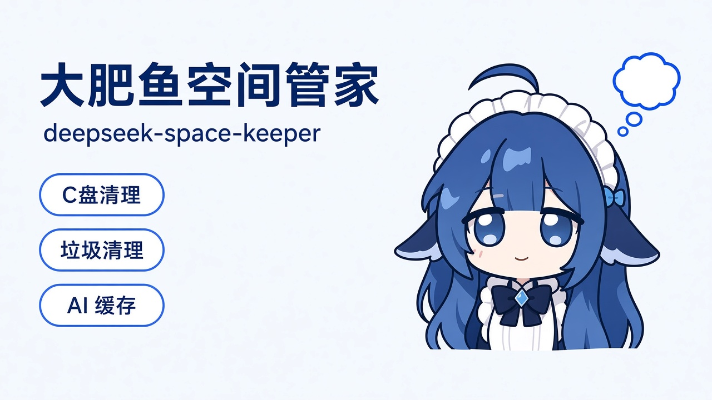
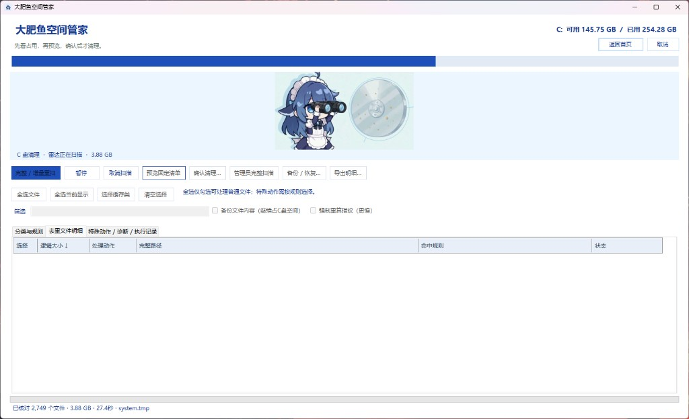
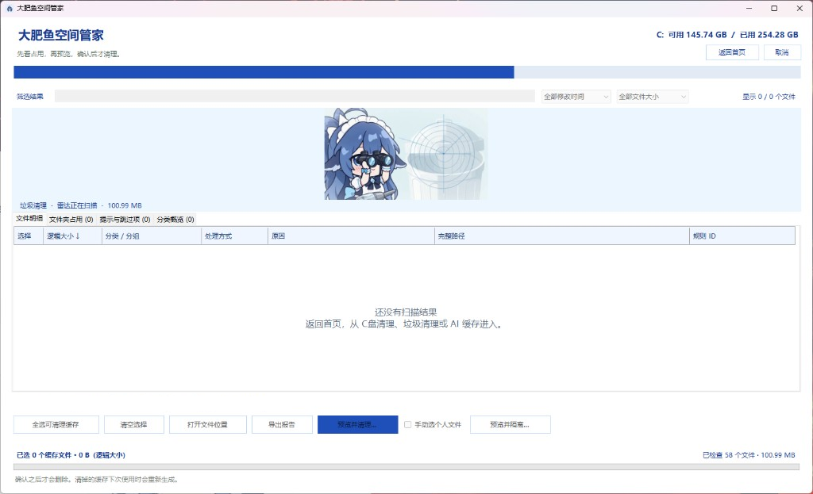
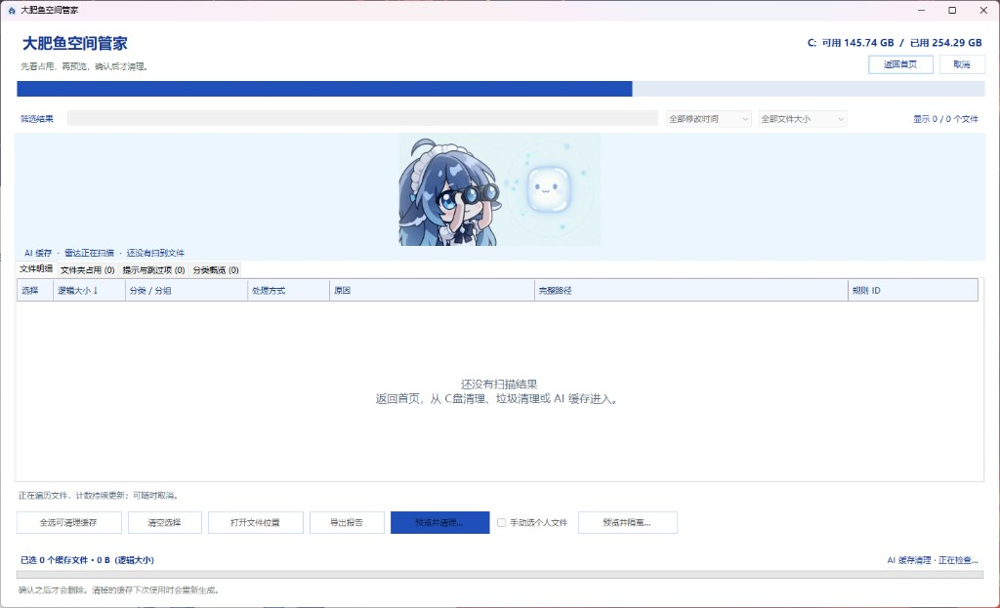
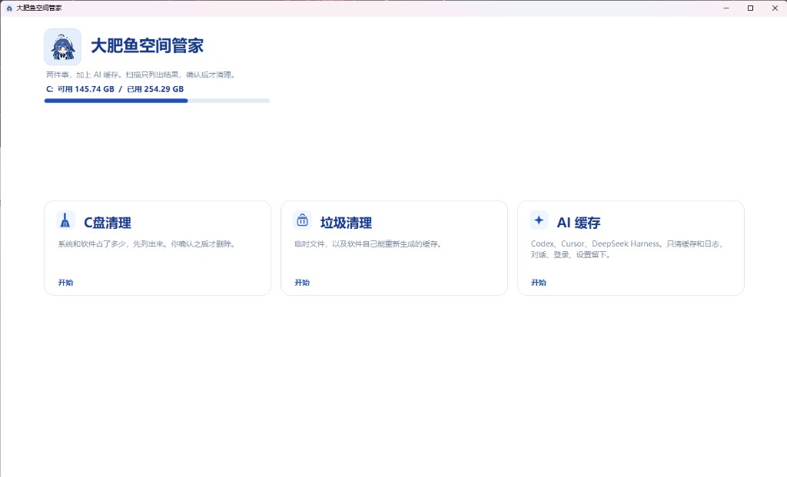

[English](README.md) | [中文](README.zh-CN.md)



# 大肥鱼空间管家

大肥鱼空间管家是 Windows 上的 C 盘清理工具。它做三件事：清理 C 盘、清理系统垃圾，以及清理 Codex、Cursor 和 DeepSeek 里可以重新生成的缓存。每次清理都先预览，确认之后才删除。不会自动勾选，对话、登录凭证和模型文件都不会动。

## 这些图是做什么的



C 盘清理正在扫描。她看着雷达圆盘，扫到多少，画面上就有多少。扫描或清理结束之后，这段画面会收起来。



垃圾清理正在扫描。旁边是垃圾桶，扫到大约 10 GB 时桶是满的。



AI 缓存正在扫描。旁边发光的是缓存。只列出 Codex、Cursor、DeepSeek 里可以重新生成的缓存和日志。



首页。三张卡片分别进入 C 盘清理、垃圾清理和 AI 缓存。


桌宠待机。单击她，会弹出 C盘清理、垃圾清理、AI 缓存。


双击她。她闭上眼，手摸着头，左右摇一摇。

## 构建

```powershell
powershell.exe -NoProfile -ExecutionPolicy Bypass -File build.ps1
```

构建不会删除文件。桌宠会一起复制到程序旁边。
